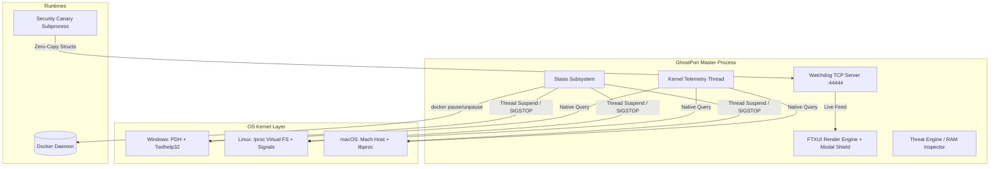

<div align="center">
  
# 🛡️ GhostPort OS
**Universal Development Environment Security & Telemetry Engine**

[](https://en.cppreference.com/w/)
[](https://microsoft.com)
[](https://kernel.org)
[](https://apple.com)
[](https://docker.com)
[](https://cmake.org/)
[](https://opensource.org/licenses/MIT)

_A multi-threaded, cross-platform native C++ daemon for Zero-Copy Port Reaping, Kernel-level Process Stasis, and Container Control across Windows, Linux, and macOS._


---

</div>

## 📖 Overview

**GhostPort OS** is an ultra-fast terminal utility engineered to solve the most frustrating bottlenecks in local software development: runaway memory leaks, locked network ports, and aggressive background containers eating CPU cycles.

Built entirely in C++20 with a multi-threaded architecture, GhostPort bypasses standard task managers by hooking directly into **OS Kernel Schedulers** (Windows PDH/Toolhelp32, Linux `/proc` & signals, macOS Mach APIs & libproc), zero-copy TCP sockets, and the Docker CLI—all wrapped in an interactive Terminal UI (TUI).

<details>
<summary><b>📋 Table of Contents (Click to Expand)</b></summary>

1. [Core Features](#-core-features)
2. [Universal Cross-Platform Architecture](#-universal-cross-platform-architecture)
3. [Global Deployment (Installation)](#-global-deployment)
4. [Privilege Auto-Elevation](#-privilege-auto-elevation)
5. [Usage & Subsystems](#-usage--subsystems)
6. [Keyboard Shortcuts](#-keyboard-shortcuts)
7. [License](#-license)
</details>

---

## ⚡ Core Features

- 📊 **Real-Time Kernel Telemetry:** True hardware-level CPU execution cycles and physical RAM consumption streamed via Windows PDH, Linux `/proc/stat`, or macOS Mach Host APIs.
- 🌐 **Zero-Copy Network Reaper & PID Resolver:** Silent background network Canary detects active dev ports, resolves the exact PID and process name (Node, Vite, React, Postgres, Redis, Spring), and kills runaway sockets.
- 🎯 **Custom Port Probe:** Interactively target and lock onto any arbitrary port number on the fly.
- 🐳 **Docker Poltergeist:** Manages and spins down Docker containers gracefully using asynchronous OS pipelining.
- ❄️ **The Stasis Chamber (Cryo-Sleep):** Halts CPU execution cycles without killing process memory state. Freezes Docker containers via Linux `cgroups` and freezes host OS processes via native `SuspendThread` (Windows) or `SIGSTOP`/`SIGCONT` (Linux & macOS).
- 🚨 **True Memory Leak Threat Engine:** Inspects resident memory footprint (`VmRSS` / Working Set) of active port owners and raises visual alerts for runaway RAM consumption.
- 🛡️ **Confirmation Modals & Safety Shields:** Prevents accidental kills or stops with an interactive confirm overlay.

---

## 🏗 Universal Cross-Platform Architecture

GhostPort delivers 100% native platform integration across all major operating systems:

| Feature Subsystem | Windows 10/11 | Linux (Ubuntu/Debian/Arch/Fedora) | macOS (Apple Silicon & Intel) |
|---|---|---|---|
| **CPU Telemetry** | Windows PDH Kernel API | `/proc/stat` delta tick analysis | Mach Kernel `host_processor_info` |
| **RAM Telemetry** | `GlobalMemoryStatusEx` | `/proc/meminfo` (Total/Available) | `sysctl hw.memsize` + `vm_statistics` |
| **Process Inspection** | PowerShell / Toolhelp32 | `/proc/<pid>/comm` + `/proc/<pid>/status` | `proc_listallpids` + `proc_pidinfo` |
| **Port PID Resolution** | `netstat -ano` + Win32 APIs | `ss -tlpn` + `/proc` inspection | `lsof -nP -iTCP` |
| **Process Stasis** | `SuspendThread` / `ResumeThread` | `SIGSTOP` / `SIGCONT` | `SIGSTOP` / `SIGCONT` |
| **Target Termination** | `taskkill /F /PID` | `kill -9 <pid>` / `fuser -k` | `kill -9 <pid>` / `lsof` |
| **Privilege Escalation**| Windows UAC `runas` | POSIX `sudo` re-exec | POSIX `sudo` re-exec |



---

## 🚀 Global Deployment

GhostPort registers itself globally into your system path so it can be summoned from any terminal, anywhere.

### Option A: Linux & macOS

```bash
# 1. Clone & Build
git clone https://github.com/NimnaOfficial/GhostPort.git
cd GhostPort

cmake -B build -S . -DCMAKE_BUILD_TYPE=Release \
  -DCMAKE_TOOLCHAIN_FILE="$VCPKG_INSTALLATION_ROOT/scripts/buildsystems/vcpkg.cmake"
cmake --build build --config Release

# 2. Deploy Globally
chmod +x deploy.sh
./deploy.sh
```

### Option B: Windows

Open PowerShell as **Administrator**:

```powershell
# 1. Clone & Build
git clone https://github.com/NimnaOfficial/GhostPort.git
cd GhostPort

cmake -B build -S . -DCMAKE_BUILD_TYPE=Release -DCMAKE_TOOLCHAIN_FILE="$env:VCPKG_INSTALLATION_ROOT\scripts\buildsystems\vcpkg.cmake"
cmake --build build --config Release

# 2. Deploy Globally
.\deploy.ps1
```

### Launch from anywhere:
```bash
ghostport
```

---

## 🛡️ Privilege Auto-Elevation

GhostPort performs root/admin checks at startup. If elevated permissions are absent, it automatically triggers elevation:
- **On Windows:** Launches a Windows UAC credential dialog via `ShellExecuteEx`.
- **On Linux & macOS:** Re-executes the process using `sudo` to prompt for password in-place.
- **Limited Mode:** If elevation is declined, GhostPort gracefully falls back to limited mode, displaying visual privilege badges and notifications.

---

## ⌨️ Keyboard Shortcuts

| Shortcut | Action |
|---|---|
| `1` or `F1` | Instant jump to **Dashboard** |
| `2` or `F2` | Instant jump to **Port Reaper** |
| `3` or `F3` | Instant jump to **Docker Poltergeist** |
| `4` or `F4` | Instant jump to **The Stasis Chamber** |
| `Tab` / `Arrow Keys` | Navigate between active UI elements |
| `Enter` | Select / Execute focused button |
| `Esc` | Cancel and dismiss Confirmation Modal |
| `Ctrl + C` | Emergency application abort |

---

## 💻 Usage & Subsystems

### 📊 1. The Dashboard (Telemetry Engine)
Provides dual split-screen graphs of live CPU execution cycles and physical RAM load, with dynamic green/yellow/red color thresholds and real-time security audit logs.

### 🌐 2. The Port Reaper (Network Security)
Scans for development servers (Node.js, React, Vite, Angular, Python, Spring, PostgreSQL, MySQL, Redis, MongoDB). Automatically identifies the owning PID, process name, and resident memory usage. Allows single-key termination.

### 🐳 3. Docker Poltergeist (Container Management)
Instantly lists all local Docker containers and enables zero-latency `SIGTERM` graceful shutdowns.

### ❄️ 4. The Stasis Chamber (Cryo-Sleep)
Freezes applications without terminating their process state. Drops CPU consumption to `0.0%` while preserving all active state in RAM. Resumed anytime with **Thaw Sequence**.

---

## 📄 License

Distributed under the **MIT License**. See `LICENSE` for details.
